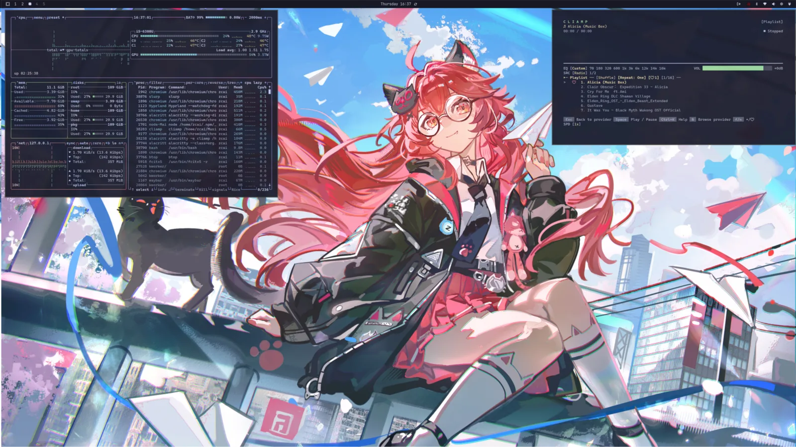
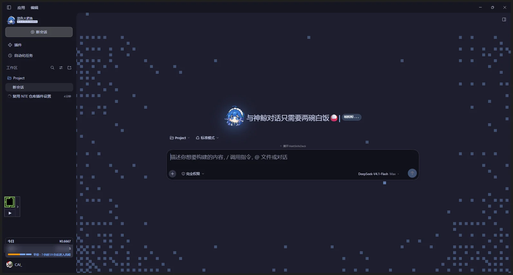
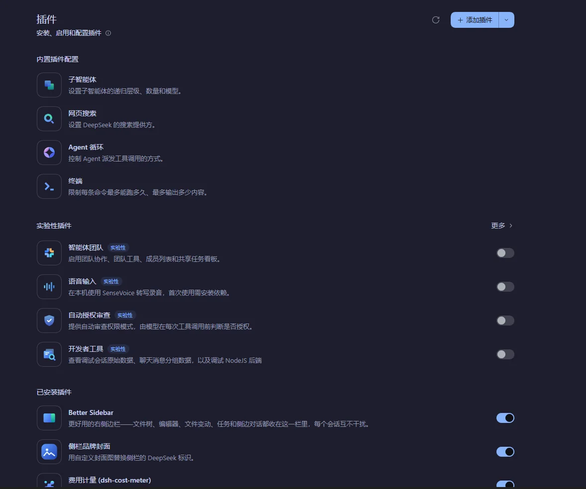

# omarchy-NTE

**Catppuccin 主题 + 异环娜娜莉壁纸的 Omarchy 桌面配置 —— 主题、输入法、窗口管理器、终端，外加一套 DSH（AI 客户端）像素皮肤，配一键安装脚本。**

[](https://archlinux.org/)
[](https://hypr.land/)
[](https://omarchy.org/)
[](#license)

<p align="center">
  
</p>

---

## 主题配置一览

| 内容 | 位置 |
|---|---|
| Hyprland / Waybar / Walker / Mako / 终端配置 | `config/hypr/`、`config/waybar/` 等 |
| **输入法（fcitx5）** | `config/fcitx5/` |
| **自动跟随主题的输入法钩子** | `config/omarchy/hooks/theme-set.d/fcitx5-follow` |
| Omarchy branding、壁纸 | `config/omarchy/branding/`、`config/omarchy/backgrounds/` |
| Neovim | `config/nvim/` |
| 复现所需的包清单 | `packages/` |
| **DSH（AI 界面）profile 与本地插件** | `dsh/` |

---

## DSH 界面皮肤 —— 同一套审美的另一半

桌面上是 Catppuccin + 娜娜莉，AI 客户端里是像素星野 + 蓝色大肥鱼。
`dsh/` 装的是一份 DeepSeek Harness（DSH）的 `web` profile：两个本地插件
（品牌封面、推理滑轨）加六个第三方 bundle，把能改的界面细节都改成了这套语言。

<p align="center">
  
</p>

图里能看到的：侧栏品牌整块换成了「蓝色大肥鱼」；新会话 hero 是一整片像素星野，
中间浮着同一个头像；标题旁挂着「哦鲸鲸…」的预览徽章；输入框右下角是模型卡片，
点开就是四档推理滑轨。

### 自定义细节

| 细节 | 来自 | 怎么做的 |
|---|---|---|
| **蓝色大肥鱼** | `dsh-brand-cover`（本地） | 1 KB 的 WebP 内联成 data URI：侧栏 24px 标记 + hero 2.2× 圆形头像，7s 漂浮 + 蓝色辉光，`prefers-reduced-motion` 下静止 |
| **哦鲸鲸…** | `dsh-brand-cover`（本地） | 官方预览徽章先 `font-size:0` 再挂 `::after` 文案，不改布局、不抢 locale 命名空间 |
| **打字机标题** | `omaseek-pixel` | 三句之一逐字 `steps()` 裁切显示，光标跟着走，停笔后继续闪 |
| **像素星野 hero** | `omaseek-pixel` | 纯 CSS 的像素边框、星点与像素图形，颜色全部走主题 token |
| **四档推理滑轨** | `dsh-effort-slider`（本地） | 替换模型卡片的「推理等级」菜单：拖动换档、扫光 + 星点两层 `transform` 动画、键盘可聚焦 |
| **Omarchy 配色** | `omaseek-themes` | 把 omarchy.org 首页的 22 套配色逐套移植成 DSH 的 32 个 design token |
| **侧栏小玩意** | `omaseek-music`、`dsh-cost-meter` | 常驻音乐卡片；今日花费、余额与峰谷价倒计时 |
| **右侧栏与 skills** | `dsh-better-sidebar`、`dsh-mattpocock-skills-deck` | 文件树、编辑器、任务、侧边对话收进右栏；ISSUE 与 map 管理 |

<p align="center">
  
</p>

### 插件清单

`dsh/profiles/web/package.json` 在官方 `dsh-base` / `dsh-web-app` 之外新增的 8 个 bundle，
版本由 `pnpm-lock.yaml` 锁定：

| Bundle | 版本 | 说明 |
|---|---|---|
| `@local/dsh-brand-cover` | 1.0.0 | 侧栏与 hero 品牌封面、「哦鲸鲸…」徽章 |
| `@local/dsh-effort-slider` | 1.0.0 | 四档推理滑轨 |
| `omaseek-themes` | 0.3.1 | 22 套 Omarchy 首页配色 → 32 个 design token |
| `omaseek-pixel` | 0.2.1 | 像素 hero + 打字机标题 |
| `omaseek-music` | 0.2.6 | 侧栏音乐卡片 |
| `dsh-better-sidebar` | 0.28.0 | 右侧栏：文件树、编辑器、任务、侧边对话 |
| `dsh-cost-meter` | 1.9.3 | 费用计量与峰谷价倒计时 |
| `dsh-mattpocock-skills-deck` | 1.9.0-beta.4 | skills deck 与 ISSUE / map 工具 |

<p align="center">
  
</p>

### profile 里还调了什么

`dsh/profiles/web/cordis.patch.yml` 只留了和界面有关的一层（节选）：

```yaml
- id: ui-chat
  config:
    transcriptView: detailed     # 默认展开工具轨迹
    performanceUsage: compact    # 用量条收窄
- id: ui-conversation
  config:
    busyEnter: steer             # 忙时回车改为插话
- id: ui-theme
  config:
    fontSize: 15
- id: better-sidebar
  config:
    agentOpenTools: true         # 工具详情直接在右栏打开
```

模型默认 `deepseek-flash`、`reasoningEffort: high`，权限预设默认 `danger-full-access`。

### 复现

`dsh/` 与 `~/.dsh` 一一对应，`install.sh` 复制前会先备份；装完要手动补一次依赖：

```bash
cd ~/.dsh/profiles/web && pnpm install
```

细节见 [`dsh/README.md`](dsh/README.md)。

<details>
<summary><b>为什么这套配置能整包搬走（点击展开）</b></summary>

<br>

- **版本对得上**：配置钉在 DSH `0.2.1-rc.2`，bundle 的 patch id（`ui-chat`、`ui-theme`、
  `permission`…）全部存在，不会出现「patch 找不到目标」。
- **路径是相对的**：两个本地插件用 `link:../../plugins/...`，在仓库内和部署到
  `~/.dsh` 之后指向同一处。
- **依赖可复现**：`pnpm-lock.yaml` 锁住 179 个包，安装时用 `--frozen-lockfile`。
- **两个补丁**：`patches/omaseek-pixel@0.2.1.patch` 和 `patches/omaseek-themes@0.3.1.patch`
  由 `pnpm-workspace.yaml` 的 `patchedDependencies` 应用。
- **Windows 桌面版同样可用**：profile 名从 `web` 换成 `desktop`、装一次依赖即可 ——
  这些插件都是纯客户端模块，不依赖 Linux 桌面组件。

</details>

---

## 系统环境

- ‼️ **Omarchy** 3.8.2 · Arch Linux · Hyprland (Wayland) · btrfs
- 主题：**Catppuccin**（Mocha，accent `#89b4fa`）
- 输入法：**fcitx5 5.1.19**
  - 面板主题 `catppuccin-mocha-blue`，字号 `Sans 13`
  - 主题由 AUR 包 [`catppuccin-fcitx5-git`](https://aur.archlinux.org/packages/catppuccin-fcitx5-git) 提供
    （56 个变体，含圆角）
  - 换 Omarchy 主题时，`fcitx5-follow` 钩子会自动同步输入法配色

---

## 快速一键安装 —— **Omarchy** 3.8.2

> 最新的 Omarchy 4.x.x 可以把仓库拉下来替换 config 以及壁纸。

### 1. 克隆

```bash
git clone https://github.com/CAI991108/omarchy-NTE.git ~/omarchy-NTE
cd ~/omarchy-NTE
```

### 2. 安装软件包（**需要 sudo，请先人工过一遍清单**）

```bash
# 官方仓库的显式包（192 个）—— 清单来自 packages/pacman-explicit.txt
less packages/pacman-explicit.txt
sudo pacman -S --needed - < packages/pacman-explicit.txt

# AUR / 外来包（7 个）
cat packages/aur-explicit.txt
omarchy pkg aur add catppuccin-fcitx5-git
```

`packages/environment.txt` 记录了本人当时的系统快照（内核、文件系统、Omarchy 与 fcitx5 版本等），
可用于核对差异。

### 3. 部署配置

```bash
./install.sh --dry-run     # 先看会改什么，不写入任何文件
./install.sh               # 真正部署
```

<details>
<summary><b><code>install.sh</code> 的行为（点击展开）</b></summary>

<br>

- **先备份**：整个 `~/.config` 快照到 `~/.config.bak.omarchy-NTE.<时间戳>`；
  每个被覆盖的文件另存为 `<文件>.bak.<时间戳>`。**不删除任何东西。**
- **幂等**：内容相同的文件直接跳过，可以反复运行。
- **重建符号链接**：`mako/config`、`btop/themes/current.theme`、
  `nvim/lua/plugins/theme.lua` 这三个指向 `omarchy/current/theme/` 的链接会被重新建立，
  并把其中的家目录路径改写为当前用户的 `$HOME`
  （它们是主题自动跟随的关键）。
- **保留可执行位**：钩子必须是可执行的，否则 Omarchy 不会运行它。
- **不碰 sudo**：只写 `$HOME` 里的文件。

</details>

### 4. 让改动生效

```bash
omarchy restart waybar
hyprctl reload
hyprctl configerrors       # 确认没有配置错误
systemctl --user restart app-org.fcitx.Fcitx5@autostart.service
```

### 5. 壁纸

壁纸放在 `config/omarchy/backgrounds/catppuccin/` —— 正是 Omarchy 会自动扫描的路径。

---

<details>
<summary><b>📁 目录结构（点击展开）</b></summary>

<br>

```
omarchy-NTE/
├── install.sh                       # 复制式部署：先备份、幂等、支持 --dry-run
├── assets/                          # README 用的压缩预览图（assets/dsh/ 是 DSH 截图）
├── config/                          # 镜像 ~/.config（只含用户改动）
│   ├── hypr/ waybar/ mako/ alacritty/ ghostty/ kitty/ btop/
│   ├── fcitx5/                      # 输入法（Theme / Font 在这里）
│   ├── omarchy/
│   │   ├── hooks/theme-set.d/fcitx5-follow    ⭐ 唯一的自定义钩子
│   │   ├── branding/                # fastfetch + 锁屏 ASCII 图案
│   │   ├── backgrounds/catppuccin/  # 当前壁纸
│   │   └── themes/                  # 自定义主题（暂空，留给以后）
│   ├── nvim/ systemd/ fontconfig/ git/ ...
│   └── *.conf  mimeapps.list  user-dirs.dirs 等散文件
├── dsh/                             # DSH (AI 界面) profile 与本地插件
│   ├── profiles/web/                # → ~/.dsh/profiles/web
│   └── plugins/                     # → ~/.dsh/plugins（dsh-brand-cover、dsh-effort-slider）
└── packages/                        # 包清单与环境快照
```

</details>

---

## Star History

[](https://star-history.com/#CAI991108/omarchy-NTE&Date)

---

## License

配置文件部分可随意取用。`config/nvim/` 源自 LazyVim / `omarchy-nvim` 包，
其 `LICENSE` 随文件保留。
