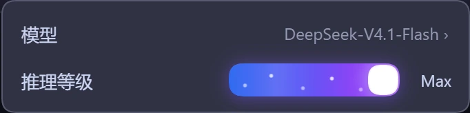
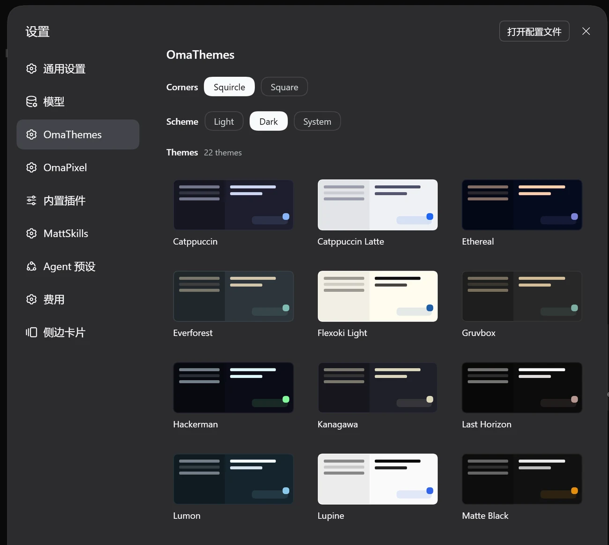
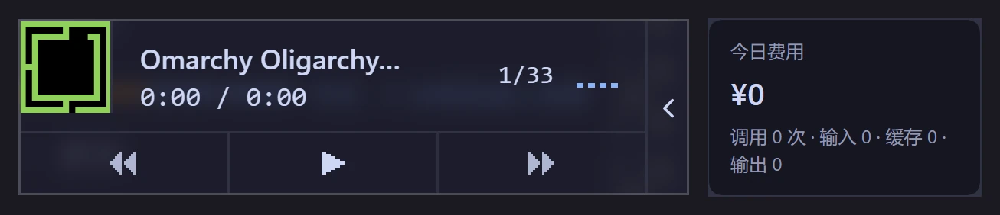
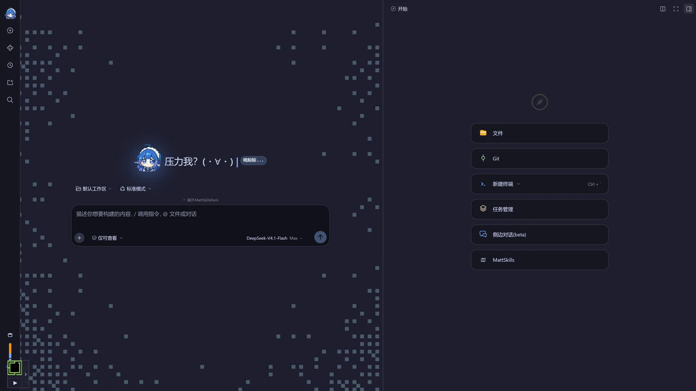

# omarchy-NTE

**Catppuccin 主题 + 异环娜娜莉壁纸的 Omarchy 桌面配置**
> —— themes、输入法、窗口管理器、终端，外加 DSH 皮肤，配一键安装脚本。

[](https://archlinux.org/)
[](https://hypr.land/)
[](https://omarchy.org/)
[](#license)

[](https://github.com/deepseek-ai/deepseek-harness)
[](https://catppuccin.com/)
[](https://fcitx-im.org/)
[](https://www.lazyvim.org/)

<p align="center">
  
</p>

---

## 主题配置一览

| 内容 | 位置 |
|---|---|
| Hyprland / Waybar / Walker / Mako / 终端配置 | `config/hypr/`、`config/waybar/` 等 |
| **输入法（fcitx5）** | `config/fcitx5/` |
| **自动跟随主题的输入法钩子** | `config/omarchy/hooks/theme-set.d/fcitx5-follow` |
| Omarchy branding、壁纸 | `config/omarchy/branding/`、`config/omarchy/backgrounds/` |
| **壁纸画廊（预览 / 下载 / 更多主题）** | <https://cai991108.github.io/omarchy-NTE-wallpaper/> |
| Neovim | `config/nvim/` |
| 复现所需的包清单 | `packages/` |
| **DSH（AI 界面）profile 与本地插件** | `dsh/` |

---

## DSH 特制主题皮肤

- Hyprland是 `Catppuccin` + `娜娜莉`，DSH端是`像素星野` + `蓝色大肥鱼`。
- `dsh/` 内含 `web` profile：插件（像素封面、推理滑轨）加六个第三方 bundle。

<p align="center">
  
</p>

>「蓝色大肥鱼」、像素星野、「哦鲸鲸…」、神鲸四档推理滑轨

### 轻量、足够有趣的组件

| Feature | 来自 | 怎么做的 |
|---|---|---|
| **蓝色大肥鱼** | `dsh-brand-cover`（本地） | 1 KB 的 WebP 内联成 data URI：侧栏 24px 标记 + hero 2.2× 圆形头像，7s 漂浮 + 蓝色辉光，`prefers-reduced-motion` 下静止 |
| **哦鲸鲸…** | `dsh-brand-cover`（本地） | 官方预览徽章先 `font-size:0` 再挂 `::after` 文案，不改布局、不抢 locale 命名空间 |
| **打字机标题** | `omaseek-pixel` | 三句之一逐字 `steps()` 裁切显示，光标跟着走，停笔后继续闪 |
| **像素星野 hero** | `omaseek-pixel` | 纯 CSS 的像素边框、星点与像素图形，颜色全部走主题 token |
| **四档推理滑轨** | `dsh-effort-slider`（本地） | 替换模型卡片的「推理等级」菜单：拖动换档、扫光 + 星点两层 `transform` 动画、键盘可聚焦 |
| **Omarchy 配色** | `omaseek-themes` | 把 omarchy.org 首页的 22 套配色逐套移植成 DSH 的 32 个 design token |
| **侧栏小玩意** | `omaseek-music`、`dsh-cost-meter` | 常驻音乐卡片；今日花费、余额与峰谷价倒计时 |
| **右侧栏与 skills** | `dsh-better-sidebar`、`dsh-mattpocock-skills-deck` | 文件树、编辑器、任务、侧边对话收进右栏；ISSUE 与 map 管理 |

<p align="center">
  
  &nbsp;&nbsp;&nbsp;
  
  &nbsp;&nbsp;&nbsp;
  
</p>

<p align="center">
  
</p>

<p align="center">
  
</p>

<p align="center">
  
</p>

<p align="center">
  
</p>

<p align="center">
  
</p>

### 复现

`dsh/` 与 `~/.dsh` 一一对应，`install.sh` 复制前会先备份；装完要手动补一次依赖：

```bash
cd ~/.dsh/profiles/web && pnpm install
```

细节见 [`dsh/README.md`](dsh/README.md)。`Super + D` 静默拉起（不占终端）：先 `systemctl --user start dsh-web`，再由 [`bin/dsh-web-open`](bin/dsh-web-open) 开窗口。

<details>
<summary><b>配置支持一键打包安装（点击展开）</b></summary>

<br>

- **版本对得上**：配置钉在 DSH `0.2.1-rc.2`，bundle 的 patch id（`ui-chat`、`ui-theme`、
  `permission`…）全部存在。
- **路径是相对的**：两个本地插件用 `link:../../plugins/...`，在仓库内和部署到
  `~/.dsh`。
- **依赖可复现**：`pnpm-lock.yaml` 锁住 179 个包，安装时用 `--frozen-lockfile`。
- **一个补丁**：`patches/omaseek-pixel@0.2.2.patch`
  由 `pnpm-workspace.yaml` 的 `patchedDependencies` 应用。
- **Windows 桌面版同样可用**：profile 名从 `web` 换成 `desktop`、装一次依赖即可 ——
  这些插件都是纯客户端模块，不依赖 Linux 桌面组件。

</details>

### DSH 活动同步到 WakaTime（可选）

`bin/dsh-wakatime` 把 DSH 会话里 `write` / `edit` / `read` 的文件操作折算成 WakaTime
心跳，复用本机 `~/.wakatime.cfg` 的 api_key（与 Neovim、VS Code 共用，**密钥不入库**）。
`install.sh` 会把它装到 `~/.local/bin`，并启用 `dsh-wakatime.timer`（每 2 分钟；
需要 `python3` 与 `zstd`）。

新机器上只差两步：

```bash
# 1) 让任意 WakaTime 编辑器插件完成一次认证（会自动下载 wakatime-cli）
# 2) 自检依赖、CLI、密钥与会话格式
~/.local/bin/dsh-wakatime doctor
```

心跳统一记为 `coding`；文件操作用文件锚点。`bash` / `run_code` **默认不计**，
需要时加 `--include-commands`（以会话目录为锚点，每 2 分钟一条，仅 git 项目）。
项目名优先取 git 仓库名，没有 git 时用会话 `cwd` 目录名兜底。
`dsh-wakatime sync --dry-run` 可预览，`status` 看进度。
运行时状态在 `~/.local/state/dsh-wakatime/`，不入库。

---

## 系统环境

- ‼️ **Omarchy** 4.0 · Arch Linux · Hyprland (Wayland) · Quickshell · btrfs
- 主题：**Catppuccin**（Mocha，accent `#89b4fa`）
- 输入法：**fcitx5 5.1.23**
  - 4.0 由 `omarchy-theme-set-fcitx5` 内置生成 `~/.local/share/fcitx5/themes/omarchy`，
    换主题时自动重建（3.8.2 时代的自定义钩子已退役）

---

## 快速一键安装 —— **Omarchy** 4.0

> 3.8.2 的完整配置在 tag [`omarchy-3.8.2`](https://github.com/CAI991108/omarchy-NTE/tree/omarchy-3.8.2)；迁移说明见 [`docs/omarchy-4.md`](docs/omarchy-4.md)。

### 1. 克隆

```bash
git clone https://github.com/CAI991108/omarchy-NTE.git ~/omarchy-NTE
cd ~/omarchy-NTE
```

### 2. 安装软件包（**需要 sudo，请先人工过一遍清单**）

```bash
# 官方仓库的显式包（192 个）—— 清单来自 packages/pacman-explicit.txt
less packages/pacman-explicit.txt
sudo pacman -S --needed - < packages/pacman-explicit.txt

# AUR / 外来包（7 个）
cat packages/aur-explicit.txt
omarchy pkg aur add catppuccin-fcitx5-git
```

`packages/environment.txt` 记录了本人当时的系统快照（内核、文件系统、Omarchy 与 fcitx5 版本等），
可用于核对差异。

### 3. 部署配置

```bash
./install.sh --dry-run     # 先看会改什么，不写入任何文件
./install.sh               # 真正部署
./install.sh --wallpapers  # 可选：额外拉取当前主题的壁纸（默认不联网）
```

<details>
<summary><b><code>install.sh</code> 的行为（点击展开）</b></summary>

<br>

- **先备份**：整个 `~/.config` 快照到 `~/.config.bak.omarchy-NTE.<时间戳>`；
  每个被覆盖的文件另存为 `<文件>.bak.<时间戳>`。**不删除任何东西。**
- **幂等**：内容相同的文件直接跳过，可以反复运行。
- **重建符号链接**：`mako/config`、`btop/themes/current.theme`、
  `nvim/lua/plugins/theme.lua` 这三个指向 `omarchy/current/theme/` 的链接会被重新建立，
  并把其中的家目录路径改写为当前用户的 `$HOME`
  （它们是主题自动跟随的关键）。
- **壁纸可选拉取**：`--wallpapers[=<theme>|all]` 会从独立仓库
  [`omarchy-NTE-wallpaper`](https://github.com/CAI991108/omarchy-NTE-wallpaper)
  读 `manifests/wallpapers.tsv`，逐张校验 sha256 后扁平安装到
  `~/.config/omarchy/backgrounds/<theme>/`。不带该参数时完全不联网；
  `--dry-run` 也不会联网。主仓库自带的壁纸按 sha 识别并跳过。
- **保留可执行位**：钩子必须是可执行的，否则 Omarchy 不会运行它。
- **不碰 sudo**：只写 `$HOME` 里的文件。

</details>

### 4. 让改动生效

```bash
omarchy restart waybar
hyprctl reload
hyprctl configerrors       # 确认没有配置错误
systemctl --user restart app-org.fcitx.Fcitx5@autostart.service
```

### 5. 壁纸

默认壁纸随 `config/omarchy/backgrounds/catppuccin/` 一起部署，保证离线装完就有桌面。

更多壁纸在独立仓库 [`omarchy-NTE-wallpaper`](https://github.com/CAI991108/omarchy-NTE-wallpaper)：
画廊 <https://cai991108.github.io/omarchy-NTE-wallpaper/>。按主题拉取：

```bash
./install.sh --wallpapers                  # 当前主题（读 Omarchy 的 theme.name）
./install.sh --wallpapers=catppuccin       # 指定主题
./install.sh --wallpapers=all              # 清单里的所有主题
./install.sh --dry-run --wallpapers=all    # 只打印计划，不联网、不写盘
```

安装器读 `manifests/wallpapers.tsv`（`WALLPAPERS_BASE` 可覆盖下载前缀，默认 GitHub raw），
逐张 sha256 校验后扁平放进 `~/.config/omarchy/backgrounds/<theme>/`。
网络或校验失败只警告，不会中断配置部署；装完按 <kbd>Super</kbd>+<kbd>Ctrl</kbd>+<kbd>W</kbd> 切换（3.8.2 下是
<kbd>Super</kbd>+<kbd>Ctrl</kbd>+<kbd>Space</kbd>）。

---

<details>
<summary><b>📁 目录结构（点击展开）</b></summary>

<br>

```
omarchy-NTE/
├── install.sh                       # 复制式部署：先备份、幂等、支持 --dry-run / --wallpapers
├── assets/                          # README 用的压缩预览图（assets/dsh/ 是 DSH 截图）
├── config/                          # 镜像 ~/.config（只含用户改动）
│   ├── hypr/ alacritty/ ghostty/ kitty/ btop/
│   ├── fcitx5/                      # 输入法（Theme / Font 在这里）
│   ├── omarchy/
│   │   ├── shell.json               # bar / 通知 / 空闲（Quickshell）
│   │   ├── branding/                # fastfetch + 锁屏 ASCII 图案
│   │   ├── backgrounds/catppuccin/  # 当前壁纸
│   │   └── themes/                  # 自定义主题（暂空，留给以后）
│   ├── systemd/ fontconfig/ git/ ...
│   └── *.conf  mimeapps.list 等散文件
├── dsh/                             # DSH (AI 界面) profile 与本地插件
│   ├── profiles/web/                # → ~/.dsh/profiles/web
│   └── plugins/                     # → ~/.dsh/plugins（dsh-brand-cover、dsh-effort-slider）
└── packages/                        # 包清单与环境快照
```

</details>

---

## Star History

[](https://star-history.com/#CAI991108/omarchy-NTE&Date)

---

## License

配置文件部分可随意取用。`config/nvim/` 源自 LazyVim / `omarchy-nvim` 包，
其 `LICENSE` 随文件保留。
